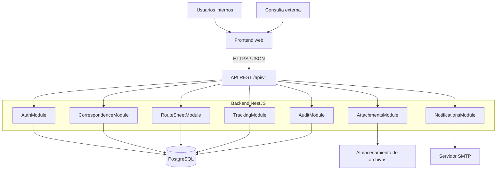

# SDD.md — Sistema de Registro y Seguimiento de Correspondencia UNIOR

> **Objetivo:** construir un MVP funcional, seguro y demostrable con el menor número de piezas posible, manteniendo una arquitectura profesional y fácil de evolucionar.
>
> **Contexto:** Universidad Privada de Oruro (UNIOR). Documento base: *Masterclass de Cierre — Trabajo* y *La arquitectura de su proyecto*.

## 1. Resumen del producto

El sistema digitaliza el registro y seguimiento de correspondencia interna y externa. Cada documento recibe un número correlativo y una hoja de ruta digital con hasta tres destinatarios. Cada destinatario puede registrar recepción con fecha y hora, clasificar el trámite como **urgente**, **archivar** o **preparar respuesta**, y registrar su salida. El sistema permite consultar el estado por número de correspondencia y detectar tramos demorados.

### Objetivos medibles del MVP

- Consultar el estado de una correspondencia en menos de **5 segundos**.
- Registrar recepción y salida por destinatario con fecha-hora automática.
- Evitar correspondencias sin estado de seguimiento por destinatario.
- Alertar cuando un tramo supere **24 horas** (meta inicial configurable).
- Proteger los datos internos y limitar la consulta externa a información autorizada.

### Supuestos operativos

- 300–400 correspondencias al mes, aproximadamente 15 por día hábil.
- 20–25 usuarios internos.
- Aproximadamente 5.000 registros por año.
- Anexos escaneados: supuesto inicial de 2 GB/año.
- Horas de mayor uso: 11:00–15:00 y 17:00–19:00.

Estos números son estimaciones de planificación y deben validarse con UNIOR.

## 2. Alcance

### Incluido en el MVP

1. Autenticación de usuarios internos.
2. Roles y autorización por ámbito.
3. Registro de correspondencia interna y externa.
4. Generación de número correlativo único.
5. Gestión de remitente, asunto, tipo, fecha de registro y anexos.
6. Hoja de ruta de hasta tres destinatarios, en orden.
7. Registro de recepción, clasificación y salida por destinatario.
8. Historial auditable de eventos y cálculo de duración por tramo.
9. Búsqueda interna por correlativo y filtros básicos.
10. Consulta externa limitada con número correlativo y dato/código de verificación.
11. Alertas de demora por correo electrónico.
12. Panel básico de seguimiento y lista de trámites demorados.

### Fuera del MVP

- Microservicios.
- Redis y caché.
- Cola de mensajes o worker independiente.
- Suite E2E extensa y pruebas de carga dedicadas.
- Analítica avanzada, firma digital certificada o integración con sistemas universitarios externos.
- Almacenamiento de objetos dedicado (MinIO/S3), salvo que la infraestructura lo exija desde el inicio.

## 3. Usuarios y permisos

| Rol | Capacidades principales |
|---|---|
| Administrador | Gestionar usuarios, roles y configuración; consultar auditoría. |
| Recepción / Ventanilla | Registrar correspondencia, adjuntar escaneos y crear hoja de ruta. |
| Destinatario interno | Ver correspondencia asignada; registrar recepción, clasificación y salida. |
| Seguimiento / Secretaría / Auditoría | Consultar el curso completo y revisar demoras dentro de su ámbito autorizado. |
| Consulta externa | Consultar únicamente el estado público permitido mediante correlativo y verificación. |

**Regla de seguridad:** el número correlativo no debe ser suficiente, por sí solo, para revelar información sensible. La respuesta pública no incluirá documentos adjuntos, datos personales innecesarios, notas internas ni la bandeja de otros usuarios.

## 4. Arquitectura propuesta

Monolito modular: es la opción más sencilla de construir y operar para el volumen esperado, sin impedir extraer módulos en el futuro.



### Tecnologías

- **Frontend:** Next.js + TypeScript, interfaz responsive.
- **Backend:** NestJS + TypeScript, API REST versionada.
- **Base de datos:** PostgreSQL.
- **ORM y migraciones:** Prisma.
- **Validación:** DTOs con `class-validator` / `class-transformer`.
- **Autenticación:** JWT para usuarios internos; guards y autorización por rol/ámbito.
- **Archivos:** almacenamiento local persistente fuera del directorio público en desarrollo; interfaz de almacenamiento abstraída para migrar a S3/MinIO. En producción, usar almacenamiento persistente respaldado y controlado.
- **Correo:** SMTP desde `NotificationsModule`, inicialmente en el mismo proceso.
- **Desarrollo local:** Docker Compose para PostgreSQL; `.env` no versionado.
- **API:** prefijo `/api/v1`; contrato documentado con Swagger/OpenAPI.

Las versiones concretas se fijarán al iniciar el repositorio y se mantendrán mediante el lockfile. No actualizar dependencias mayores sin revisar compatibilidad.

## 5. Skills de skills.sh para arrancar

Instalar únicamente skills que ayuden al flujo real de desarrollo. Verificar nombre, propietario, instrucciones y permisos en el catálogo antes de ejecutarlas; revisar su contenido antes de confiar en ellas.

### Skills recomendadas (slugs verificados en el catálogo)

1. **`vercel-labs/agent-skills` → `vercel-react-best-practices`**: patrones y rendimiento de React/Next.js. Referencia: [skills.sh/topic/react](https://www.skills.sh/topic/react).
2. **`anthropics/skills` → `frontend-design`**: dirección visual e implementación de interfaces frontend. Referencia: [skills.sh](https://skills.sh/).
3. **`prisma/skills` → `prisma-database-setup`**: configuración inicial de Prisma y base de datos. Referencia: [skills.sh](https://skills.sh/).

Instalación sugerida desde la raíz del repositorio (la CLI permite seleccionar skills concretas; verifica el prompt y la sintaxis de la versión instalada):

```bash
npx skills add vercel-labs/agent-skills --skill vercel-react-best-practices
npx skills add anthropics/skills --skill frontend-design
npx skills add prisma/skills --skill prisma-database-setup
```

Si la CLI o el catálogo devuelve un slug distinto, prioriza el identificador publicado actualmente. Antes de aceptar una skill, revisa `SKILL.md`, su repositorio de origen y los comandos/permisos que propone. No compartas secretos con una skill ni ejecutes scripts no revisados. Mantén las tres solo si aportan valor al proyecto.

## 6. Modelo de datos inicial

El esquema final se definirá en `prisma/schema.prisma`. Entidades recomendadas:

- **User:** id, nombre, email, passwordHash, role, departmentId, active, createdAt.
- **Department:** id, nombre, código, active.
- **Correspondence:** id, trackingNumber (único), direction/type, subject, summary, senderName, senderOrganization, registeredAt, createdById, currentStatus.
- **RouteSheet:** id, correspondenceId (único), createdAt, createdById.
- **RouteRecipient:** id, routeSheetId, userId/departmentId, sequence (1–3), status, receivedAt, actionType, dispatchedAt, notes internas.
- **Attachment:** id, correspondenceId, originalName, storageKey, mimeType, sizeBytes, checksum, uploadedById, createdAt.
- **TrackingEvent:** id, correspondenceId, recipientId opcional, eventType, fromStatus, toStatus, actorId, occurredAt, metadata controlada.
- **PublicTrackingToken:** id, correspondenceId, tokenHash, expiresAt opcional, revokedAt opcional.
- **NotificationLog:** id, recipient, template, status, attempts, sentAt, errorCode.
- **AuditLog:** id, actorId, action, entityType, entityId, occurredAt, requestId, metadata minimizada.

### Integridad y reglas

- `trackingNumber` único y generado en el servidor, sin depender del frontend.
- Crear correspondencia, hoja de ruta, destinatarios y evento inicial dentro de una transacción.
- `sequence` limitado a 1–3 por hoja de ruta y sin duplicados.
- Fechas de recepción/salida generadas por servidor y almacenadas en UTC; presentación en zona horaria configurada para la institución.
- No sobrescribir eventos históricos: registrar eventos nuevos.
- Evitar eliminación física de correspondencias con historial; aplicar archivado lógico si la política institucional lo permite.
- Definir política de retención, acceso y respaldo antes de producción.

## 7. Flujos principales

### A. Registrar correspondencia

1. Usuario autorizado completa datos obligatorios.
2. Backend valida DTO y permisos.
3. Backend asigna correlativo único.
4. Se guardan correspondencia, hoja de ruta, hasta tres destinatarios y evento inicial en una transacción.
5. Se almacenan los anexos fuera del directorio público y se persisten solo sus metadatos/referencias en PostgreSQL.
6. Se confirma el registro y se muestra el correlativo.

### B. Procesar un destinatario

1. El destinatario autenticado abre una asignación que le corresponde.
2. Marca recepción; el servidor fija `receivedAt`.
3. Selecciona **urgente**, **archivar** o **preparar respuesta**.
4. Registra salida; el servidor fija `dispatchedAt`.
5. Se calcula el tiempo del tramo y se registra un evento de auditoría.
6. Si corresponde, se notifica al siguiente destinatario y/o al equipo de seguimiento.

Las transiciones permitidas deben validarse en el backend. El frontend no decide permisos ni establece marcas de tiempo oficiales.

### C. Consulta externa

1. El solicitante introduce el correlativo y el dato/código de verificación.
2. Backend aplica limitación de intentos y valida el dato sin revelar si otros datos son correctos.
3. Se devuelve una vista pública mínima: recibido, en curso, finalizado o estado equivalente aprobado por la institución.
4. Nunca se devuelve la hoja de ruta interna completa ni anexos privados.

## 8. API inicial

Todos los endpoints bajo `/api/v1`. Rutas orientativas que deben quedar documentadas con Swagger:

| Método | Endpoint | Uso |
|---|---|---|
| POST | `/auth/login` | Iniciar sesión interna |
| GET | `/users/me` | Perfil del usuario autenticado |
| POST | `/correspondences` | Registrar correspondencia y hoja de ruta |
| GET | `/correspondences` | Listado filtrado según permisos |
| GET | `/correspondences/:id` | Detalle interno autorizado |
| GET | `/correspondences/by-number/:number` | Búsqueda interna por correlativo |
| POST | `/correspondences/:id/attachments` | Subir anexo |
| POST | `/route-recipients/:id/receive` | Registrar recepción |
| PATCH | `/route-recipients/:id/action` | Marcar urgente/archivar/preparar respuesta |
| POST | `/route-recipients/:id/dispatch` | Registrar salida |
| GET | `/tracking/public` | Consulta externa con correlativo y verificación |
| GET | `/tracking/overdue` | Listar tramos demorados, según permisos |
| GET | `/audit` | Consultar auditoría, solo roles autorizados |

Usar paginación, límites de tamaño, validación estricta y respuestas de error consistentes. No exponer errores internos, SQL, stack traces ni secretos.

## 9. Seguridad y privacidad

- Hash de contraseñas con algoritmo moderno apropiado; nunca guardar contraseñas en texto plano.
- JWT de vida limitada y estrategia definida de renovación/revocación.
- Guards por autenticación, rol y ámbito; validar acceso a cada recurso para evitar IDOR.
- HTTPS en producción, CORS restrictivo y secretos en variables de entorno/gestor de secretos.
- Validar MIME real, extensión y tamaño de anexos; nombres aleatorios de almacenamiento y descarga autorizada.
- Limitar intentos de consulta pública y evitar enumeración de correlativos.
- Registrar eventos sensibles sin guardar contraseñas, tokens ni datos personales innecesarios en logs.
- Protección contra fuerza bruta, inyección, XSS y CSRF según el mecanismo de autenticación elegido.
- Copias de seguridad cifradas y prueba documentada de restauración.
- Definir con la institución quién puede consultar remitentes, asuntos, anexos y tiempos de trámite.

## 10. Requisitos no funcionales

- **Rendimiento:** consulta de estado menor a 5 s; objetivo interno inicial p95 menor a 1 s en condiciones normales.
- **Disponibilidad:** despliegue sencillo y procedimiento de recuperación documentado.
- **Accesibilidad:** formularios etiquetados, navegación por teclado, contraste suficiente y mensajes de error claros.
- **Trazabilidad:** toda transición relevante queda asociada a actor y fecha-hora del servidor.
- **Mantenibilidad:** módulos de dominio, servicios pequeños, DTOs y reglas de negocio fuera de los controllers.
- **Portabilidad:** Docker para dependencias locales y configuración por entorno.

## 11. Estructura del repositorio

Se recomienda monorepo con pnpm workspaces:

```text
unior-correspondencia/
├── apps/
│   ├── web/                 # Next.js
│   └── api/                 # NestJS
├── packages/
│   └── shared/              # Tipos/contratos compartidos, sin lógica sensible
├── prisma/                  # schema y migraciones (o dentro de apps/api)
├── docs/
│   ├── architecture.md
│   └── api.md
├── docker-compose.yml
├── .env.example
├── .gitignore
├── package.json
├── pnpm-workspace.yaml
└── SDD.md
```

Si el tiempo de entrega es muy corto, evitar abstraer paquetes compartidos hasta que exista una necesidad concreta. Mantener Prisma y sus migraciones en un único lugar.

## 12. Plan de implementación rápido

### Fase 0 — Arranque (medio día)

- Crear repositorio, workspace, lint, formato y TypeScript estricto.
- Añadir `.env.example`, Docker Compose con PostgreSQL y healthcheck.
- Instalar y revisar 2–3 skills elegidas desde skills.sh.
- Crear esquema inicial de Prisma y documentar decisiones.

### Fase 1 — Base vertical (1 día)

- Configurar NestJS, Prisma, PostgreSQL, migración inicial y Swagger.
- Crear Next.js con layout, navegación y componentes básicos.
- Configurar manejo de errores, validación DTO y logging mínimo.

### Fase 2 — Identidad y registro (1–2 días)

- Login interno, guards, roles y usuarios semilla de desarrollo.
- Crear correspondencia con correlativo transaccional.
- Crear hoja de ruta y asignaciones de destinatarios.
- Implementar listado, búsqueda y detalle.

### Fase 3 — Seguimiento (1–2 días)

- Recepción, clasificación y salida por destinatario.
- Historial de eventos y cálculo de tiempos por tramo.
- Consulta pública protegida y limitación de intentos.
- Vista de demoras y alertas básicas.

### Fase 4 — Anexos y notificaciones (1 día)

- Carga y descarga autorizada de anexos.
- SMTP configurable; registrar resultado de envío.
- No bloquear el flujo principal si el correo falla; registrar error y permitir reintento administrativo simple.

### Fase 5 — Endurecimiento y demo (1 día)

- Pruebas unitarias de reglas críticas y autorización.
- Probar permisos entre usuarios y acceso público.
- Revisar responsive, accesibilidad, validaciones y mensajes.
- Ejecutar migraciones desde una base limpia, preparar datos demo y redactar README.

**Recorte si el plazo es extremo:** completar primero registro → hoja de ruta → recepción/salida → consulta interna. Después consulta pública, anexos y correo. No recortar autorización ni auditoría de estados.

## 13. Criterios de aceptación

- [ ] Un usuario autorizado registra una correspondencia y recibe un correlativo único.
- [ ] La hoja de ruta admite entre uno y tres destinatarios ordenados.
- [ ] Solo el destinatario autorizado puede registrar recepción, acción y salida de su tramo.
- [ ] El sistema fija fecha-hora de recepción/salida en servidor.
- [ ] Cada transición queda en el historial y no se pierde al actualizar el estado actual.
- [ ] La duración del tramo se calcula correctamente.
- [ ] Los tramos que exceden el umbral aparecen como demorados.
- [ ] La búsqueda interna devuelve la correspondencia correcta por correlativo.
- [ ] La consulta externa requiere verificación y devuelve solo campos públicos.
- [ ] Un usuario no autorizado no puede acceder a correspondencias de otro ámbito.
- [ ] Los anexos no son accesibles por URL pública directa.
- [ ] El proyecto puede iniciarse desde cero siguiendo el README y las migraciones.
- [ ] Existe un conjunto mínimo de pruebas automatizadas para correlativo, transiciones, permisos y consulta pública.

## 14. Estrategia de pruebas

- **Unitarias:** generación de correlativo, reglas de transición, cálculo de duración y detección de demora.
- **Integración:** transacciones de registro, repositorios Prisma, permisos y endpoints públicos.
- **Manual de aceptación:** flujo completo de recepción a salida con 1, 2 y 3 destinatarios.
- **Seguridad:** acceso cruzado entre usuarios, enumeración de correlativos, archivos no autorizados y límites de intentos.
- **E2E completo:** posponer hasta que la interfaz y el flujo cambien con frecuencia; cubrir manualmente el camino crítico en el MVP.

## 15. Decisiones y señales para evolucionar

| Decisión inicial | Motivo | Señal para reconsiderarla |
|---|---|---|
| Monolito modular NestJS | Volumen bajo y equipo pequeño | Módulos con necesidades de escalado/despliegue independientes |
| PostgreSQL + Prisma | Relaciones fuertes, transacciones y migraciones | No hay señal prevista para cambiar de base de datos |
| SMTP en el proceso API | Bajo volumen de correo | Más de ~500 emails/día o envíos bloqueando la API |
| Sin Redis/caché | Consulta simple con índices | Seguimiento supera 1 s de forma sostenida |
| Sin cola de mensajes | Operación inicial pequeña | Fallos/retrasos de notificación o necesidad de reintentos robustos |
| Almacenamiento de archivos abstraído | Mantener MVP simple y migrable | Anexos >10 GB o necesidad de respaldo/almacenamiento externo |
| E2E limitado inicialmente | Reducir tiempo de arranque | Regresiones manuales >4 h por release o equipo >3 personas |
| Observabilidad básica | Adecuada para primera versión | Más de dos incidentes de seguimiento no detectados por usuarios |

## 16. Entregables del proyecto

- Aplicación web y API funcionales.
- Migraciones versionadas de PostgreSQL.
- `.env.example` sin secretos.
- Datos de prueba claramente identificados como no productivos.
- Swagger/OpenAPI.
- README con instalación, variables de entorno, migraciones, ejecución y pruebas.
- Diagrama de arquitectura actualizado.
- Lista de decisiones técnicas y limitaciones conocidas.

## 17. Primeros pasos de implementación

1. Confirmar reglas institucionales del correlativo, privacidad, roles y retención documental.
2. Crear el monorepo y arrancar PostgreSQL local con Docker Compose.
3. Verificar e instalar 2–3 skills de skills.sh; revisar sus instrucciones.
4. Crear `schema.prisma`, aplicar la primera migración y sembrar usuarios ficticios.
5. Implementar el primer flujo vertical completo: **registrar → asignar → recibir → clasificar → despachar → consultar**.
6. Añadir pruebas a las reglas de negocio antes de ampliar funcionalidades.

---

**Principio rector:** priorizar un flujo de correspondencia completo, auditable y seguro sobre una arquitectura sobredimensionada. Cada componente adicional debe justificar qué problema real resuelve.
