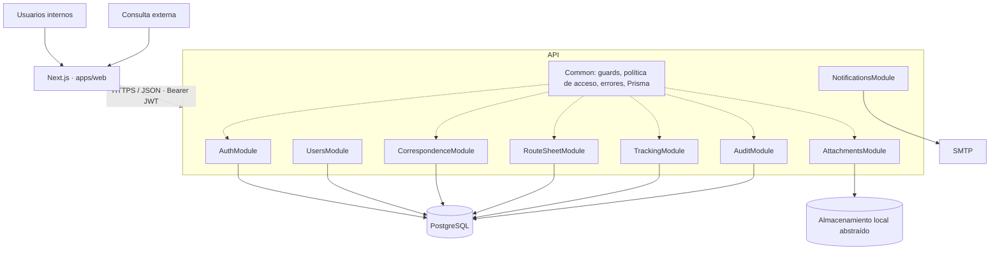
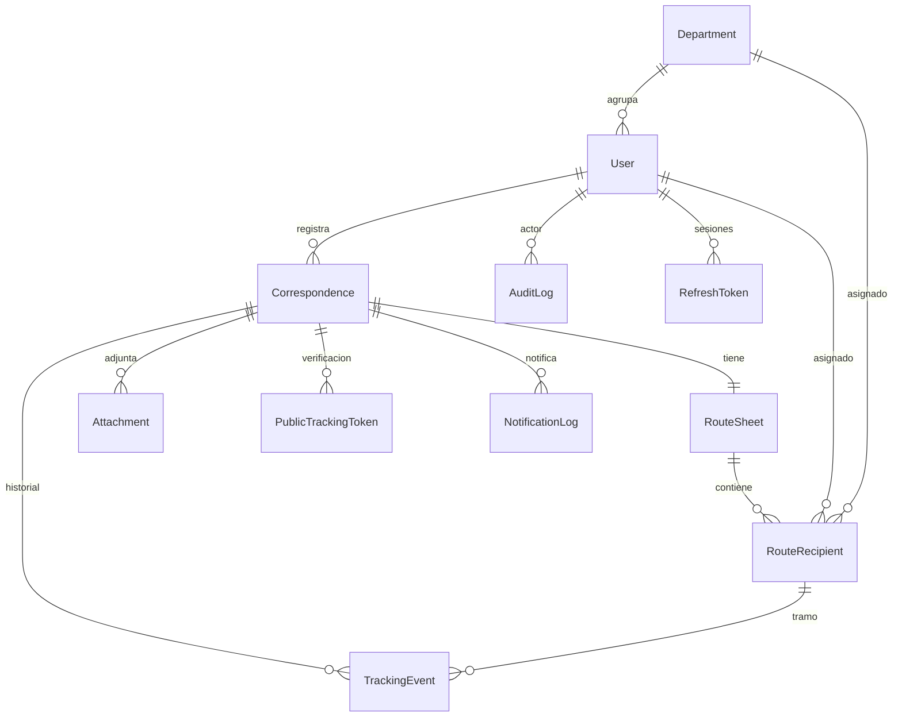

# Arquitectura — Sistema de Correspondencia UNIOR

## 1. Contexto y fuerzas

- 300–400 correspondencias/mes, 20–25 usuarios internos, ~5.000 registros/año.
- Equipo pequeño, entrega corta, operación sencilla de mantener y respaldar.
- Necesidad fuerte de **trazabilidad** (quién recibió, cuándo, qué hizo) y de **privacidad** (consulta externa mínima).

La respuesta arquitectónica es un **monolito modular** con API REST versionada, una sola base de datos relacional y un frontend Next.js. No se introducen microservicios, caché, colas ni workers: el volumen no los justifica y agregarían superficie operativa.

## 2. Diagrama de componentes

## 3. Módulos y responsabilidades

| Módulo           | Responsabilidad                                                                                   | Piezas clave                                                               |
| ---------------- | ------------------------------------------------------------------------------------------------- | -------------------------------------------------------------------------- |
| `auth`           | Login, emisión/rotación/revocación de tokens, perfil.                                             | `AuthService`, `password.ts`, `AuthController`                             |
| `users`          | CRUD de usuarios (ADMIN), cambio de contraseña.                                                   | `UsersService`, `user.mapper.ts`                                           |
| `departments`    | Catálogo para asignaciones.                                                                       | `DepartmentsController`                                                    |
| `correspondence` | Registro transaccional, correlativo, listado/detalle, archivo lógico, rotación de código público. | `CorrespondenceService`, `correlative.ts`, mappers                         |
| `route-sheet`    | Recepción, clasificación y salida por tramo; sincronización del estado global.                    | `RouteRecipientService`, `transitions.ts`                                  |
| `tracking`       | Demoras, métricas del panel, consulta pública y alertas.                                          | `TrackingService`, `PublicTrackingService`, `overdue.ts`, `public-code.ts` |
| `attachments`    | Carga/descarga autorizada y almacenamiento abstraído.                                             | `AttachmentsService`, `StorageService`, `file-validation.ts`               |
| `notifications`  | Envío SMTP no bloqueante y bitácora de envíos.                                                    | `NotificationsService`, `MailerService`, plantillas                        |
| `audit`          | Registro transversal de operaciones y consulta (ADMIN/SEGUIMIENTO).                               | `AuditService`, `AuditInterceptor`, `audit-action.ts`                      |
| `common`         | Prisma, guards globales, filtro de errores, política de acceso, paginación, fechas.               | `access.policy.ts`, `date.utils.ts`, `AllExceptionsFilter`                 |

Los controladores solo traducen HTTP; las reglas viven en servicios y, cuando son puras (transiciones, duración, correlativo, acceso), en funciones independientes y probadas.

## 4. Modelo de datos

Reglas de integridad:

- `Correspondence.trackingNumber` único y generado **en el servidor** dentro de una transacción que también crea hoja de ruta, destinatarios, evento inicial y token público.
- Secuencia por año en `correlative_sequences`, incrementada de forma atómica con `INSERT ... ON CONFLICT ... RETURNING` (sin huecos por carreras).
- `RouteRecipient` con `sequence` 1–3 y único por hoja de ruta.
- Fechas oficiales (`registeredAt`, `receivedAt`, `classifiedAt`, `dispatchedAt`) fijadas por el servidor en UTC; la zona `America/La_Paz` se usa solo para presentación y corte del día.
- Los eventos históricos no se sobrescriben: cada transición agrega `TrackingEvent`.
- No se borran correspondencias con historial: `isArchived` + estado `ARCHIVADA`.

## 5. Flujos

### Registro

`POST /correspondences` → validación DTO y de destinatarios → transacción (secuencia atómica, correlativo, correspondencia + hoja de ruta + tramos + evento `REGISTRO` + token público) → notificación al primer destinatario (sin bloquear) → respuesta con detalle y código público (único momento en que se muestra).

### Tramo

`receive` → `PENDIENTE→RECIBIDO`; `action` → `RECIBIDO→CLASIFICADO` (urgente/archivar/preparar respuesta); `dispatch` → `CLASIFICADO→DESPACHADO`. Cada paso usa `updateMany` condicionado por el estado esperado (evita dobles transiciones por concurrencia), registra evento y recalcula el estado global (`REGISTRADA/EN_TRAMITE/ATENDIDA`).

### Consulta externa

`GET /tracking/public?number&code` → búsqueda por correlativo, verificación del HMAC del código (comparación en tiempo constante), límite de intentos, respuesta mínima (estado público y tramos genéricos) y auditoría del intento.

### Alertas de demora

`GET /tracking/overdue` calcula la duración de cada tramo abierto y filtra por umbral; `POST /tracking/overdue/notify` envía un resumen al equipo de seguimiento y registra el resultado (enviado/omitido/fallido) sin bloquear.

## 6. Seguridad aplicada

- Autenticación por JWT en guard global; revalidación del usuario en cada petición (desactivación inmediata).
- Autorización por rol + política de ámbito (`canAccessCorrespondence`, `canActOnRecipient`) aplicada tanto al detalle como al filtro Prisma de listados.
- Contraseñas bcrypt, tokens de refresco hasheados, rotación y detección de reutilización.
- Validación de entrada estricta, límites de tamaño, CORS, helmet, throttling y mensajes de error sin datos internos.
- Anexos con validación de firma binaria, claves aleatorias y descarga autenticada.
- Auditoría con actor y `requestId`, sin secretos ni cuerpos de petición.

## 7. Operación

- **Desarrollo:** PostgreSQL vía Docker Compose; migraciones con `prisma migrate dev`; seed de datos no productivos.
- **Producción:** `prisma migrate deploy`, `pnpm build`, proceso Node detrás de HTTPS, volumen persistente para `STORAGE_DIR`, respaldo cifrado de base de datos y archivos, y SMTP institucional.
- **Observabilidad mínima:** logs estructurados de Nest con `X-Request-Id` correlacionable con auditoría; los errores 5xx se registran con traza solo en el servidor.
- **Recuperación:** restaurar respaldo de PostgreSQL, volver a desplegar la misma versión y verificar `/api/v1/tracking/stats` y el login.

## 8. Evolución prevista

| Señal                                                  | Cambio sugerido                              |
| ------------------------------------------------------ | -------------------------------------------- |
| > 10 GB de anexos o respaldo externo exigido           | Implementar `StorageService` sobre S3/MinIO. |
| Envíos SMTP bloqueando la API o > 500/día              | Extraer notificaciones a un worker/cola.     |
| p95 de seguimiento > 1 s sostenido                     | Vista materializada o caché.                 |
| Múltiples instancias con límite de intentos compartido | Almacén de throttling compartido (Redis).    |
| Módulos con necesidades de despliegue independiente    | Extraer servicio conservando contratos REST. |
